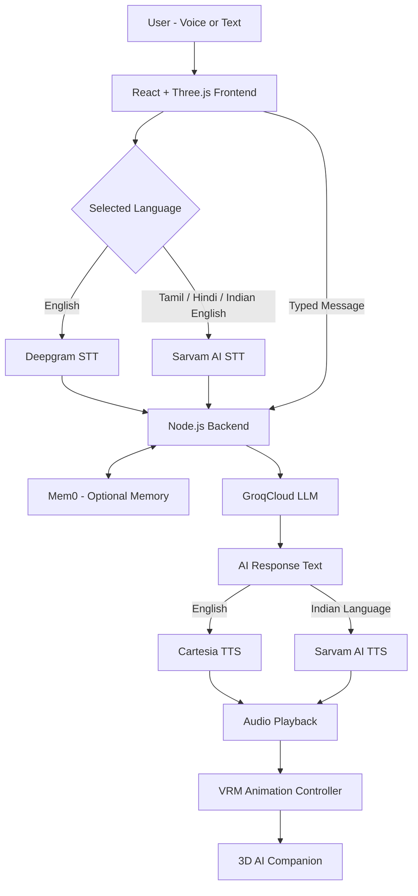

# ZIRUMI

### Your World. Your Companion.

**A voice-first, multilingual 3D AI companion with expressive virtual characters, conversational intelligence, and opt-in memory.**

[](https://react.dev/)
[](https://threejs.org/)
[](https://vite.dev/)
[](https://nodejs.org/)
[](https://github.com/mohamed-kaif-1/Zirumi-3d-AI-)

[**Explore the code**](https://github.com/mohamed-kaif-1/Zirumi-3d-AI-) · [**Quick start**](#quick-start) · [**Architecture**](#system-architecture) · [**Security**](#security-and-privacy)

---

## Overview

**ZIRUMI** is a browser-based interactive AI companion that lets people **speak, type, and interact** with four distinct 3D virtual characters.

Instead of presenting AI as a traditional text-only chatbot, ZIRUMI combines speech recognition, large language model inference, neural voice synthesis, session history, optional long-term memory, and real-time avatar animation into one experience.

Users can choose **Aira, Luna, Mira, or Zyra**, switch conversation languages, speak naturally, and hear the selected character answer through a configured synthetic voice.

The application renders rigged VRM humanoids with Three.js, drives speaking animations from audio playback, and supports interactive hand inverse kinematics (IK).

**Built for:** Embodied AI, human–computer interaction, multimodal interfaces, virtual companions, and multilingual speech experiences.

> **Project Status:** The core speech, conversation, voice, memory, and language integrations have undergone automated and browser verification during development. This is an evolving prototype, not yet a production-ready public SaaS.

---

## Key Features

- **Four AI Companions:** Distinct personalities, character identities, and configured voices.
- **Voice-First Conversations:** Speech recognition, AI-generated responses, and natural voice synthesis.
- **Multilingual Communication:** English, Tamil, Hindi, and Indian English.
- **Interactive 3D Avatars:** VRM-based humanoid characters powered by Three.js.
- **Expressive Animation:** Facial expressions, gestures, speaking animations, and skeletal movement.
- **Interactive Hand IK:** User-controlled hand positioning through inverse kinematics.
- **Personalized AI Memory:** Opt-in preference memory using Mem0.
- **Context-Aware Conversations:** AI responses based on recent messages and relevant memories.
- **Character Switching:** Switch companions without losing completed session conversations.
- **Modular AI Infrastructure:** Integrated Deepgram, GroqCloud, Cartesia, Mem0, and Sarvam AI.
- **Secure API Architecture:** Provider credentials handled by the backend instead of the frontend.

---

## Meet the AI Companions

ZIRUMI includes four virtual companions with unique personalities and voice configurations.

| Companion | Personality | Behavior |
|---|---|---|
| **Aira** | Sweet, Friendly, Caring | Warm responses, gentle expressions, reassuring communication |
| **Luna** | Playful, Cheerful, Expressive | Energetic greetings, cheerful conversations, lively gestures |
| **Mira** | Calm, Elegant, Intelligent | Thoughtful explanations, composed posture, clear communication |
| **Zyra** | Confident, Energetic, Futuristic | Dynamic responses, confident gestures, engaging presentation |

### Character Architecture

Each character has:

- A dedicated visual identity.
- A VRM humanoid avatar.
- Personality-specific instructions.
- Character voice configuration.
- Facial expression and animation behavior.
- Shared conversational intelligence.
- Access to user-approved contextual memory.

One conversational language model powers all four characters.

Their different behavior comes from personality instructions, voice assignments, and animation configuration rather than training four separate AI models.

### Character IDs

| Character | Internal ID | Cartesia Voice Variable |
|---|---|---|
| Aira | `default` | `CARTESIA_VOICE_AIRA` |
| Luna | `sky` | `CARTESIA_VOICE_LUNA` |
| Mira | `nova` | `CARTESIA_VOICE_MIRA` |
| Zyra | `ember` | `CARTESIA_VOICE_ZYRA` |

---

## Technology Stack

ZIRUMI combines frontend engineering, 3D graphics, AI inference, speech technologies, and personalized memory.

| Category | Technology | Purpose |
|---|---|---|
| Frontend | React 19 | Interactive application interface |
| Build Tool | Vite 7 | Development server and production bundling |
| Programming Language | JavaScript / JSX | Frontend and backend functionality |
| 3D Engine | Three.js | Real-time 3D rendering |
| React 3D Integration | React Three Fiber | React-based 3D components |
| 3D Utilities | Drei | Scene and rendering utilities |
| Avatar Format | VRM | Rigged humanoid character models |
| Avatar Runtime | @pixiv/three-vrm | VRM loading, humanoid skeletons, and expressions |
| Backend | Node.js | API endpoints and service orchestration |
| Conversational AI | GroqCloud | Large language model inference |
| Speech Recognition | Deepgram Nova-3 | English speech-to-text |
| Voice Synthesis | Cartesia Sonic | Character-specific English voices |
| Long-Term Memory | Mem0 | Persistent preference memory |
| Indian-Language AI | Sarvam AI | Tamil, Hindi, and Indian-English speech |
| Browser Audio | MediaRecorder / Web Audio | Voice recording and audio processing |
| Animation | Skeletal Animation and IK | Character movement and interaction |
| Version Control | Git and GitHub | Source management |

---

## System Architecture



### Architecture Components

**1. User Interface**

The React frontend manages the conversation interface, character selection, microphone controls, settings, and 3D avatar rendering.

**2. Speech Recognition**

Deepgram and Sarvam transform recorded user speech into text.

**3. AI Conversation Engine**

GroqCloud hosts the language model used to understand messages and generate context-aware responses.

**4. Persistent Memory**

Mem0 stores approved user preferences and retrieves relevant information when memory is enabled.

**5. Speech Synthesis**

Cartesia and Sarvam convert generated text into audio through configured synthetic voices.

**6. 3D Animation Engine**

Three.js renders the avatars and coordinates facial and skeletal movement with audio playback.

---

## How ZIRUMI Works

### Step 1 — Voice Input

The user speaks using their microphone.

The frontend captures audio through browser MediaDevices and MediaRecorder APIs.

### Step 2 — Speech-to-Text

The application selects the recognition provider according to the selected language.

| Language | Provider |
|---|---|
| English | Deepgram |
| Tamil | Sarvam AI |
| Hindi | Sarvam AI |
| Indian English | Sarvam AI |

The service returns the recognized text.

### Step 3 — Context and Memory Retrieval

The backend prepares the conversational context using:

- Selected character personality.
- Recent conversation history.
- Latest user message.
- Selected language.
- Relevant opt-in Mem0 memories.

### Step 4 — AI Response Generation

GroqCloud processes the conversation context using the configured language model.

The generated response reflects the selected character's conversational style.

### Step 5 — Text-to-Speech

The text response is passed to the configured speech-generation provider.

English conversations use Cartesia by default.

Supported Indian-language conversations use Sarvam AI.

### Step 6 — Avatar Animation

The resulting audio is played in the browser.

The character's speaking state and mouth movement are coordinated with audio playback.

The avatar can also display supported expressions, head movements, and skeletal gestures.

### Step 7 — Continue the Conversation

The user can continue speaking, type another message, or switch between virtual companions.

---

## 3D Avatar and Animation System

ZIRUMI uses Three.js and VRM technology to render and animate humanoid characters.

### 3D Rendering

The rendering engine handles:

- Character geometry.
- Materials and textures.
- Lighting.
- Camera positioning.
- Model loading.
- Visual animation updates.

### Humanoid Skeleton

Each VRM model contains humanoid bone mappings used to control its movement.

Important bone regions include:

- Head and neck.
- Spine and chest.
- Shoulders.
- Upper arms.
- Lower arms.
- Hands.
- Hips and legs.

### Inverse Kinematics

Inverse kinematics allows an avatar's joints to respond to a target position.

For example, when the user drags a character's hand, the IK controller calculates suitable movements for the wrist, elbow, and shoulder.

### Facial Animation

The avatar system supports facial and speaking expressions according to each model's available VRM capabilities.

### Lip Synchronization

The documented baseline uses Web Audio amplitude to drive mouth animation during synthesized speech playback.

More precise phoneme-to-viseme alignment is a future improvement.

**Important:** Audio-driven mouth motion should not be confused with fully verified phoneme-accurate lip synchronization.

### Future Animation Improvements

Planned improvements include:

- Additional conversational hand gestures.
- More realistic body postures.
- Speech-aware gesture scheduling.
- More natural facial expressions.
- Collision-aware limb movement.
- Improved viseme synchronization.
- Better gaze behavior.
- More expressive character-specific animations.

---

## AI Memory System — Mem0

ZIRUMI integrates Mem0 to support optional personalized conversations.

### Short-Term Memory

The application uses recent conversation messages to maintain context during a session.

### Long-Term Memory

When the user enables memory, the application can store approved preferences for future conversations.

For example:

**User:**
"Remember that I prefer explanations with examples."

**Later conversation:**
"Explain machine learning."

ZIRUMI can retrieve the stored preference and provide an explanation with examples.

### Memory Features

- User-controlled opt-in memory.
- Relevant memory retrieval.
- Preference-based personalization.
- Memory inspection.
- Memory deletion.
- Scoped memory access.

Persistent memory is not required for normal conversations.

Production deployment requires authenticated user identities and independently verified access controls.

---

## Multilingual Communication

ZIRUMI supports four language modes.

### English

Deepgram → GroqCloud → Cartesia

### Tamil

Sarvam STT → GroqCloud → Sarvam TTS

### Hindi

Sarvam STT → GroqCloud → Sarvam TTS

### Indian English

Sarvam STT → GroqCloud → Sarvam TTS

The selected conversation language influences speech recognition, response generation, and speech output.

### Example Tamil Conversation

**User:**

வணக்கம், உன் பெயர் என்ன?

**ZIRUMI:**

வணக்கம்! என் பெயர் ஐரா. உங்களுடன் பேசுவதில் மகிழ்ச்சி!

### Example Hindi Conversation

**User:**

नमस्ते, तुम्हारा नाम क्या है?

**ZIRUMI:**

नमस्ते! मेरा नाम मीरा है। मैं आपकी कैसे मदद कर सकती हूँ?

---

## Quick Start

### Prerequisites

Install:

- Node.js 22.12 or later.
- npm.
- Git.
- A modern browser supporting WebGL and microphone access.

Obtain API credentials for the services you intend to use.

### 1. Clone the Repository

```bash
git clone https://github.com/mohamed-kaif-1/Zirumi-3d-AI-.git
cd Zirumi-3d-AI-
```

### 2. Install Dependencies

```bash
npm ci
```

### 3. Create Environment Configuration

For Windows CMD:

```cmd
if not exist .env copy .env.example .env
```

For PowerShell:

```powershell
if (-not (Test-Path .env)) {
    Copy-Item .env.example .env
}
```

Edit `.env` with your API credentials.

### 4. Start the Backend

Open a terminal:

```bash
npm run server
```

The backend uses port `3001` by default.

### 5. Start the Frontend

Open another terminal:

```bash
npm run dev
```

### 6. Open ZIRUMI

Visit:

http://127.0.0.1:5173

Both frontend and backend must be running for live AI features to function.

---

## Environment Configuration

The following example uses placeholders only.

```dotenv
# ==============================
# GROQCLOUD - CONVERSATIONAL AI
# ==============================

GROQ_API_KEY=your_groq_api_key
GROQ_CHAT_MODEL=openai/gpt-oss-20b

# ==============================
# DEEPGRAM - SPEECH RECOGNITION
# ==============================

DEEPGRAM_API_KEY=your_deepgram_api_key
DEEPGRAM_STT_MODEL=nova-3

# ==============================
# CARTESIA - CHARACTER VOICES
# ==============================

CARTESIA_API_KEY=your_cartesia_api_key
CARTESIA_TTS_MODEL=sonic-3.6

CARTESIA_VOICE_AIRA=your_voice_uuid
CARTESIA_VOICE_LUNA=your_voice_uuid
CARTESIA_VOICE_MIRA=your_voice_uuid
CARTESIA_VOICE_ZYRA=your_voice_uuid

# ==============================
# MEM0 - LONG-TERM MEMORY
# ==============================

MEM0_API_KEY=your_mem0_api_key
MEMORY_ENABLED=false

# ==============================
# SARVAM AI - INDIAN LANGUAGES
# ==============================

SARVAM_API_KEY=your_sarvam_api_key

SARVAM_STT_MODEL=saaras:v4
SARVAM_TTS_MODEL_TA=bulbul:v3
SARVAM_TTS_MODEL_HI=bulbul:v4-flash
SARVAM_TTS_MODEL_EN=bulbul:v4-flash

# ==============================
# APPLICATION SETTINGS
# ==============================

DEFAULT_STT_PROVIDER=deepgram
DEFAULT_TTS_PROVIDER=cartesia
DEFAULT_LANGUAGE=en

TRANSCRIPTION_PORT=3001
```

Use the repository's `.env.example` for the complete and current configuration.

**Never commit real API keys to GitHub.**

### API Provider Dashboards

- [GroqCloud](https://console.groq.com/keys)
- [Deepgram](https://console.deepgram.com/)
- [Cartesia](https://play.cartesia.ai/)
- [Mem0](https://app.mem0.ai/)
- [Sarvam AI](https://dashboard.sarvam.ai/)

---

## Project Structure

```text
Zirumi-3d-AI-/
│
├── public/
│   ├── models/
│   └── fonts/
│
├── src/
│   └── React frontend and 3D avatar components
│
├── server/
│   └── Node.js backend and AI services
│
├── scripts/
│   └── Testing and verification utilities
│
├── test/
│   └── Automated tests
│
├── .env.example
├── .gitignore
├── index.html
├── package.json
├── package-lock.json
├── vite.config.js
├── netlify.toml
└── README.md
```

---

## Backend APIs

| API Endpoint | Function |
|---|---|
| `POST /api/transcribe` | Converts recorded speech into text |
| `POST /api/chat` | Generates AI responses |
| `POST /api/tts` | Converts AI-generated text into speech |
| Memory-related endpoints | Manage approved conversational memory |

The backend coordinates provider selection, request validation, API credentials, and error handling.

---

## Testing and Verification

Run the automated checks:

```bash
npm test
npm run lint
npm run build
```

For optional live provider tests:

```bash
npm run test:live
```

Live testing requires configured API credentials and may consume provider credits.

### Manual Testing Checklist

- [ ] All four characters load successfully.
- [ ] Character switching works correctly.
- [ ] Text conversations work.
- [ ] English microphone input is transcribed.
- [ ] Tamil and Hindi language routing works.
- [ ] Character-specific voices play correctly.
- [ ] Mouth animation responds to actual speech playback.
- [ ] Hand IK interactions work.
- [ ] Character gestures remain smooth.
- [ ] Memory opt-in works.
- [ ] Memory retrieval and deletion work.
- [ ] Switching characters stops outdated audio playback.
- [ ] No API credentials are exposed in the frontend.
- [ ] The application builds without errors.

Some automated audio tests use simulated microphone input. They do not replace real-device speech and animation verification.

---

## Security and Privacy

ZIRUMI processes user messages, microphone recordings, and optional memory information.

Security considerations include:

- API secrets remain on the backend.
- Microphone recording requires user permission.
- Persistent memory is opt-in.
- Memory access must be scoped to the correct user.
- Requests are validated before reaching AI providers.
- Cloud-service failures should return controlled errors.
- User audio should not be retained unnecessarily.
- Sensitive data must not be exposed through frontend logs.

Public deployment requires stronger protections, including authentication, rate limiting, abuse prevention, and secure user identity handling.

---

## Deployment

ZIRUMI can be deployed as a publicly accessible web application.

However, its frontend and backend must both be hosted.

### Suggested Architecture

```text
GitHub Repository
       |
       v
React + Vite Frontend
    (Netlify)
       |
       v
Node.js Backend
     (Render)
       |
       v
External AI Providers
```

The frontend can be hosted using a static hosting platform.

The backend must be deployed separately or through another compatible server environment.

A static frontend deployment alone cannot handle protected AI API requests.

### Important Deployment Requirements

- Configure a public HTTPS backend.
- Update API routing for production.
- Store credentials using backend environment settings.
- Configure allowed origins correctly.
- Implement production authentication for persistent memory.
- Add server-enforced rate limits.
- Monitor AI API consumption.
- Restrict anonymous users from unlimited provider usage.
- Review model distribution and hosting licenses.

### Cost-Aware Public Demo

A public deployment may consume AI credits quickly.

A safer demonstration approach is:

- Allow visitors to view and interact with 3D models.
- Provide cached character voice demonstrations.
- Restrict live AI requests.
- Enable full AI access for authorized testers.
- Monitor remaining API quotas.

---

## Avatar Assets and Licensing

ZIRUMI uses third-party VRM model assets.

Check the model attribution and license information before redistributing or publicly hosting them.

See:

[Avatar Attribution](public/models/ATTRIBUTION.md)

The repository documents Luna, Mira, and Zyra as CC0-licensed beta VRoid sample characters.

The original Aira model has different, more restrictive embedded usage conditions.

In particular, the recorded terms restrict redistribution and modification.

**The presence of an avatar file in a public repository does not automatically grant permission to redistribute it.**

Obtain appropriate permission or replace the restricted asset before further public distribution.

Font assets may have their own license notices.

---

## Future Roadmap

- [ ] Advanced hand gesture animation library.
- [ ] Natural full-body posture transitions.
- [ ] More expressive facial animation.
- [ ] Phoneme-to-viseme lip synchronization.
- [ ] Better collision-aware inverse kinematics.
- [ ] Speech-aware animation scheduling.
- [ ] Real-time streaming voice conversations.
- [ ] Reduced conversational response latency.
- [ ] Improved multilingual speech quality.
- [ ] Authenticated user accounts.
- [ ] Secure multi-user persistent memory.
- [ ] Production deployment with API quotas.
- [ ] Mobile responsiveness improvements.
- [ ] Performance profiling and optimization.

---

## Example Conversations

### Aira — Friendly Explanation

**User:**

"Explain machine learning with a simple everyday example."

**Aira:**

Explains the concept using a warm and approachable conversational style.

### Luna — Playful Interaction

**User:**

"Tell me something fun and give me an energetic greeting."

**Luna:**

Responds with an enthusiastic conversational style and supported expressive animations.

### Mira — Technical Explanation

**User:**

"Explain artificial intelligence in three simple steps."

**Mira:**

Provides a clear and organized explanation with a composed conversational personality.

### Zyra — Motivational Interaction

**User:**

"Help me plan an exciting project."

**Zyra:**

Uses a confident and energetic response style.

---

## Real-World Applications

### AI Education

Virtual AI tutors capable of explaining subjects through natural-language conversations.

### Virtual Assistants

Character-based assistants for information retrieval, guidance, and everyday tasks.

### Multilingual Interfaces

Conversational systems supporting users who prefer Indian languages.

### Gaming and Entertainment

Interactive AI characters and NPCs with dynamic dialogue.

### Virtual Customer Support

Branded conversational characters capable of assisting customers through text and speech.

### Human–Computer Interaction Research

A platform for experimenting with conversational interfaces, embodied interaction, and multimodal AI systems.

---

## Technical Contributions

ZIRUMI focuses on integrating multiple AI technologies into a unified interactive application.

Its major engineering areas include:

- AI provider orchestration.
- Speech recognition integration.
- Neural speech synthesis.
- Character personality configuration.
- Context-aware conversation management.
- Personalized memory retrieval.
- Multilingual routing.
- VRM humanoid rendering.
- Skeletal animation.
- Inverse kinematics.
- Audio-driven facial animation.
- Frontend and backend integration.
- API validation and error handling.

ZIRUMI does not train a new foundational language model.

Instead, it integrates existing pretrained AI models with custom application logic and interactive 3D rendering.

---

## Contributing

Contributions, bug reports, feature suggestions, and improvements are welcome.

Before contributing:

- Review existing issues.
- Follow the application's code structure.
- Avoid committing API credentials.
- Respect avatar asset licenses.
- Run the available tests.
- Document significant changes.

---

## Developer

**Mohamed Kaif**

Computer Science and Engineering

Loyola-ICAM College of Engineering and Technology, Chennai.

**GitHub:** [@mohamed-kaif-1](https://github.com/mohamed-kaif-1)

**Repository:** [ZIRUMI 3D AI Companion](https://github.com/mohamed-kaif-1/Zirumi-3d-AI-)

---

## Project Vision

ZIRUMI explores a future where interactions with artificial intelligence extend beyond conventional chat interfaces.

By combining conversational AI, speech processing, personalized memory, multilingual communication, and interactive 3D characters, the platform aims to make AI experiences more natural, expressive, and approachable.

The long-term vision is to develop virtual companions that communicate through coordinated speech, facial expressions, gestures, and context-aware interaction while maintaining appropriate user controls, privacy, and reliability.

---

### ZIRUMI — Your World. Your Companion.

*Giving conversational AI a voice, a face, and a more expressive interface.*
